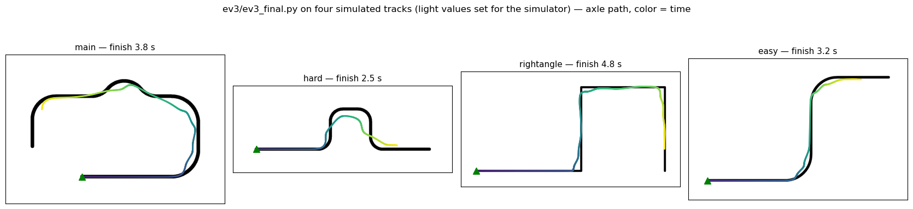

# Pybricks line-following simulator · SPIKE Prime & EV3

English | [한국어](README.ko.md)

[](https://github.com/ijunsoo/Low_level_hardware_linetracing_for_ev3-spike/actions/workflows/ci.yml)
[](LICENSE)

Run your **unmodified** [Pybricks](https://pybricks.com) line-following program on a PC, in a simulator calibrated against real LEGO SPIKE Prime and EV3 robots.
The repository also contains the two competition robots the simulator was built for.

**▶ [Try it in your browser](https://ijunsoo.github.io/Low_level_hardware_linetracing_for_ev3-spike/)** — no install: pick a program or paste your own, change the robot's shape, pick or build an arena, and watch it drive.



- **Your code, unchanged.** A mock `pybricks` package (hubs, pupdevices, ev3devices, iodevices, robotics, tools, parameters) lets the same file run on the robot and in the simulator.
- **Calibrated physics.** Motor lag, turning slip, gear torque limits, sensor footprint, noise and lag, and the loop rate of real hubs — fitted to black-box logs recorded on real robots.
- **Tracks.** Curves, right angles, competition-style tracks with crossings and loops, a track traced from a photo of a real competition field, or your own.
- **Measure, don't guess.** Randomized worlds, paired A/B comparisons, regression tests, and a decoder for black-box logs from the real robot.
- **GPU and RL.** A PyTorch version of the simulator runs 16,384 robots at once. Train a PPO policy and export it as integer-only Pybricks code.
- **In the browser.** The same Python simulator runs in a web page with [Pyodide](https://pyodide.org): live animation, sensor readings, motor plots, a test in 8 randomized worlds, a robot editor and an arena editor.

## Quick start

Python 3.9+.

```bash
git clone https://github.com/ijunsoo/Low_level_hardware_linetracing_for_ev3-spike.git
cd Low_level_hardware_linetracing_for_ev3-spike
pip install -r requirements.txt
python sim/run_sim.py examples/spike_simple_follower.py --profile spike_3s_geo2 --track main
```

```text
running: .../examples/spike_simple_follower.py / track: main / profile: spike_3s_geo2
result: {'reason': 'finish', 'time_s': 4.347, 'progress_mm': 2136.3, 'track_mm': 2174.3, 'mean_lat_mm': 17.23}
plot saved: sim_result.png
```

For EV3: `python sim/run_sim.py examples/ev3_simple_follower.py --profile ev3_3s_geo --track main`. More in [`examples/`](examples/).

## Browser simulator

[Open it](https://ijunsoo.github.io/Low_level_hardware_linetracing_for_ev3-spike/), or run it locally:

```bash
python web/build.py                                   # → web/dist/
python -m http.server 8000 --directory web/dist       # then open http://localhost:8000
```

It is the repository's own simulator (`sim/core.py` and the Pybricks mock) running in a Web Worker with Pyodide, so results match the PC.
The program menu has both competition programs, the reinforcement-learning policy and the examples; GitHub Actions rebuilds and publishes it on every push (`.github/workflows/pages.yml`).

- **Robot editor** — sensors (how many, where, which port, white/black brightness), wheel diameter, wheel spacing, gear ratio and motor ports, with a live top view. A quick-layout helper puts N sensors in a row.
- **Arenas** — the built-in tracks, endless random arenas generated from the competition rules (pick a number), and an arena editor: write the route piece by piece (`S 500` straight, `A 150 90` curve, `T -90` sharp corner, `M x1 y1 x2 y2` marker), preview it, save it, and share it as a JSON file.
- Your robots and arenas are saved in your browser.

## Run your own program

1. Write a normal Pybricks program for SPIKE Prime or EV3.
2. Pick a robot profile whose ports match your wiring (`python sim/run_sim.py --list`), or [describe your own robot](docs/SIM_API.md).
3. Run it:

   ```bash
   python sim/run_sim.py my_program.py --profile spike_3s_geo --track main
   ```

The run ends with `finish`, `lost`, `timeout` or `stall`, and a plot is saved to `sim_result.png` (`--no-plot` to skip).
Useful options: `--track photo@1.3` (scaled photo track), `--offset 20` (start beside the line), `--seed 3` (other sensor noise), `--lost 450` (more room before 'lost'), `--sub "OLD=>NEW"` (change a constant without editing the file).

What the mock supports — and what it doesn't — is listed in [`docs/SIM_API.md`](docs/SIM_API.md).

## Documentation

| Document | Contents |
|---|---|
| [`sim/README.md`](sim/README.md) | Simulator guide: profiles, tracks, evaluation tools, regression tests, GPU simulator and RL, calibration, limitations |
| [`docs/SIM_API.md`](docs/SIM_API.md) | Supported Pybricks API, robot profile keys, track format |
| [`docs/PHYSICS_ENGINE.md`](docs/PHYSICS_ENGINE.md) | Would a physics engine make the simulator match the real robot? Public motor data, MuJoCo tests, what still has to come from black boxes |
| [`examples/`](examples/) | Short beginner programs that run in the simulator and on the robot |
| [`README.ko.md`](README.ko.md) | Korean: the competition robots, wiring, how they drive, experiment results |

## The robots in this repository

Two robots for the Robotex Korea LEGO line-following competition (20 mm line, right angles, crossings, loops), both with three EV3 color sensors in a row, 23 mm apart and 170 mm ahead of the axle.
They always drive at full power and steer only; the one exception is a 50 ms brake before a right angle at the end of a long straight.

| | SPIKE Prime | EV3 |
|---|---|---|
| Final program | [`spike/spike_final.py`](spike/spike_final.py) | [`ev3/ev3_final.py`](ev3/ev3_final.py) |
| Light-value tool | [`spike/spike_value.py`](spike/spike_value.py) | [`ev3/ev3_value.py`](ev3/ev3_value.py) |
| Sensor reading | EV3 color sensors through `PUPDevice`, raw red reflection | `ColorSensor.reflection()` (RGB) by default |

Everything a student needs to change is in the last line of each final program. The robot code comments are in Korean; the details are in [`README.ko.md`](README.ko.md).

Some findings from the simulator and the robots:

- Doubling the gear ratio did not make pivots faster on the real robot — the motors run out of torque — so the 2× model (`spike_3s_geo2x`) slows turning down to match.
- Robots get trapped in small loops when the sensor arm (170 mm) is longer than the loop radius; whether the second turn catches the exit at the crossing decides it.
- On the EV3, RGB reflection followed the line better than raw red reflection, even with both calibrated.

## Repository layout

| Folder | Contents |
|---|---|
| `sim/` | Simulator, tools, regression tests; `sim/rl/` GPU simulator and RL |
| `spike/`, `ev3/` | Robot programs |
| `examples/` | Beginner examples |
| `web/` | Browser simulator (Pyodide) — `web/build.py` builds it |
| `docs/` | Reference documents and figures |
| `diag_logs/` | Black-box and diagnostic logs from the real robots |

## Contributing

Issues and pull requests are welcome, in English or Korean.
Before opening a pull request, run `python sim/regress.py`; CI runs it on every push.

## License

[MIT](LICENSE)
